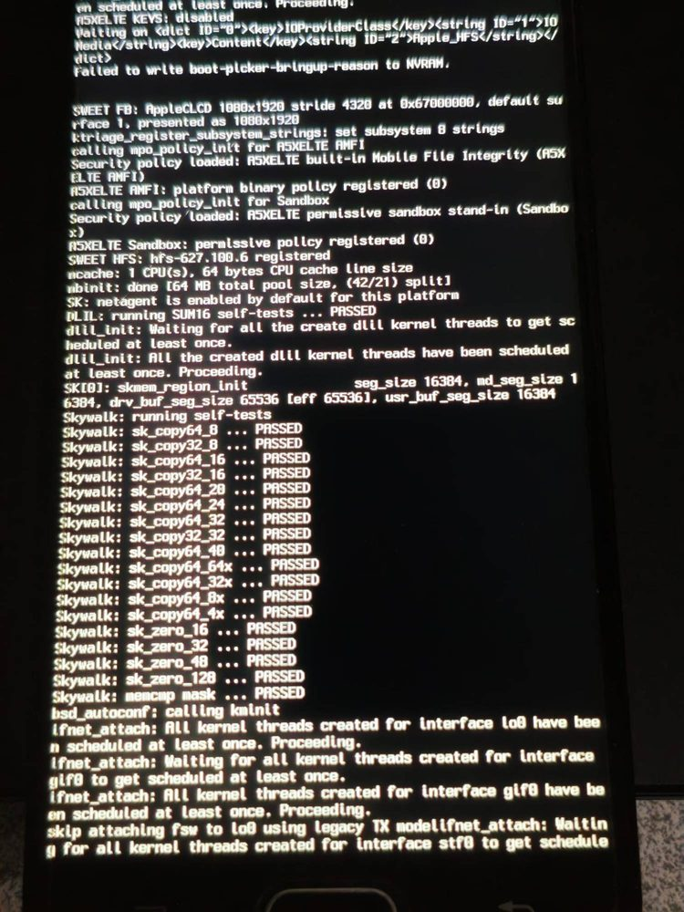
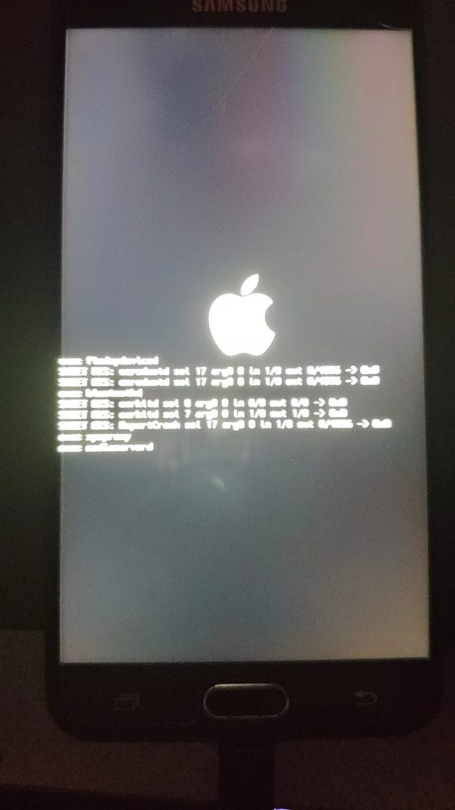
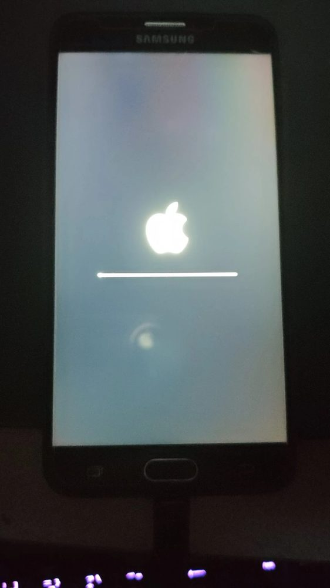
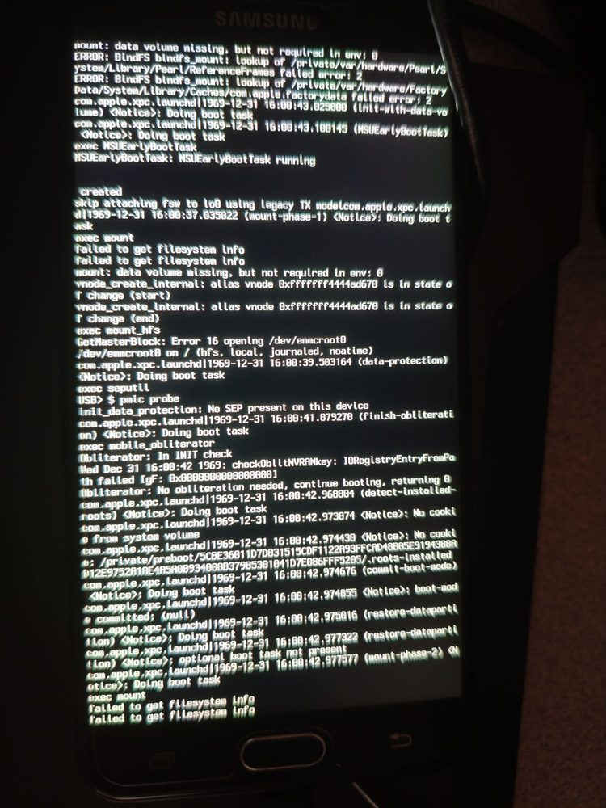
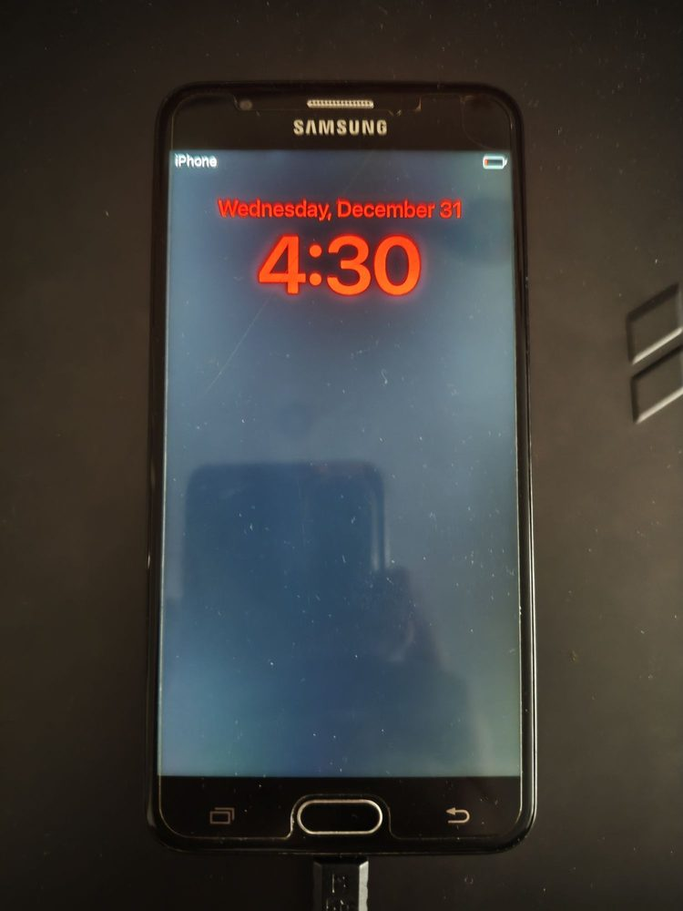

# ios-on7xelte

**English** | [Türkçe](#türkçe)

**Apple's iOS 16 kernel and userland on the Samsung Galaxy J7 Prime (SM-G610F, `on7xelte`).**

This repository ports Apple's open-source XNU kernel (xnu-8796.141.3, the iOS 16 generation) to the
Exynos 7870 and boots the stock iOS 16.7 (20H392) iPhone X userland from the phone's internal eMMC.
CoreAnimation draws on the Mali-T830 GPU through Mesa's panfrost driver.

> **Status: 2026-11-15, project paused.**
> The J7 Prime boots XNU on all 8 cores, mounts an HFS+ iOS root from the `userdata` partition and
> runs `launchd`, backboardd and SpringBoard. The home screen, touch, keyboard, Wi-Fi and Safari
> work. CoreAnimation renders on the GPU with zero-copy IOSurfaces. The full engineering log and
> the last hand-off are in [`NOTES.md`](NOTES.md).

## Photos

| First XNU boot | Apple logo | Boot progress | launchd boot log | Lock screen |
| :---: | :---: | :---: | :---: | :---: |
|  |  |  |  |  |
| XNU on the Exynos 7870, 2026-11-08 | iOS boot on the panel | Progress bar | HFS+ root from eMMC, launchd boot tasks | iOS 16 lock screen, 2026-11-09 |

## Device

| | |
| --- | --- |
| Model | Samsung Galaxy J7 Prime, SM-G610F (`on7xelte`) |
| SoC | Exynos 7870: 8x Cortex-A53, ARMv8.0 (no LSE, no PAN) |
| GPU | Mali-T830 MP1 (Midgard), driven by our kernel backend + Mesa 25.0.7 panfrost |
| Storage | eMMC; BOOT = `mmcblk0p10`, iOS root in `userdata` (`mmcblk0p25`), GPT unchanged |
| Display | 1080x1920 TD4300 panel; the bootloader leaves the DECON scan-out buffer at `0x67000000` |
| Interrupts | GIC-400 (GICv2): distributor `0x104E1000`, CPU interface `0x104E2000` |
| USB | Works: adb/TWRP for flashing, and a USB ACM serial line for the kernel log and commands |

The phone is an experimental bring-up target. Android has been removed from `userdata`; the
bootloader, recovery (TWRP), modem, EFS/persist and the partition backups are kept intact.

## What works

| Area | State |
| --- | --- |
| Kernel | XNU boots through the shim, 4K pages, GICv2, generic timer, 8-core SMP, CPU DVFS |
| Storage | eMMC driver with multi-block and DMA reads, read/write HFS+ root in `userdata` |
| Userland | `launchd`, backboardd, SpringBoard and system daemons from the iOS 16.7 root |
| Display | Presented as an iPhone 8 Plus (1242x2208, 414x736 pt @3x) and scaled to the 1080x1920 panel on 4 CPU threads at 60 Hz |
| Input | Touchscreen, hardware keys, on-screen keyboard |
| Power | Battery level, panel brightness and sleep, RTC |
| Wi-Fi | SDIO Broadcom chip with our own driver: scan, WPA2 join, DHCP, auto-join; Safari browses |
| GPU | Mali-T830 power, MMU, job IRQs; Mesa panfrost in user space; CoreAnimation in backboardd draws through `libon7gl` (EAGLContext on Mesa) with zero-copy IOSurfaces |

Experimental: the audio codec and speaker path, the `sweetfb_2x=1` @2x display mode (828x1472,
about twice as fast on the GPU).

Not working: cellular, Bluetooth, camera, sensors, Metal (apps that need Metal do not run).

## How it boots

```
Samsung S-Boot (unlocked)
  -> BOOT partition (p10): Samsung boot.img
     -> shim (shim/on7xelte): EL1, display/PMU/CMU setup, copies XNU + ADT + boot-args
        -> XNU-8796 (MACHINE_CONFIG=A5XELTE, Exynos 7870 addresses)
           -> HFS+ root in userdata (rd=emmcroot0 emmcroot=USERDATA)
              -> launchd -> backboardd (+ libon7gl, Mesa panfrost) -> SpringBoard
```

Every test is a temporary BOOT image: the phone is sent to TWRP over USB, the image is written to
`mmcblk0p10`, read back and verified, and the phone reboots. The kernel log arrives over the USB
serial line.

## Building

The kernel is built by GitHub Actions on `macos-15` with
[blacktop/darwin-xnu-build](https://github.com/blacktop/darwin-xnu-build): `xnu.yml` fetches
xnu-8796.141.3, applies `xnu/patches/` in order, scans for ARMv8.1 LSE instructions (the
Cortex-A53 has none) and uploads `kernel.development.a5xelte`.

```sh
gh workflow run xnu.yml -R furkan-karapinar/ios-on7xelte
gh run download RUN_ID -R furkan-karapinar/ios-on7xelte -n xnu-kernel -D ci/xnu-kernel-RUN_ID
```

`mesa.yml` builds Mesa (OSMesa + panfrost) for iOS arm64, the `hakios-drm` shim and
`libon7gl.dylib` (artifact `gpu-userland`). The kernel installs `libon7gl` on the root at boot from
an embedded payload (patch 0194, `tools/on7put-payload.py`).

The boot image is made with `tools/mkpayload.py` (kernel + Apple Device Tree + boot-args) and
`tools/on7xelte-pack-probe.py` (shim + payload into the Samsung boot image).

## Patch series

`xnu/patches/` holds the whole series, applied in order. `0001`-`0083` are the ios-sweet base,
`0084`-`0136` the Exynos A5XELTE series this port started from, `0137` onwards the J7 Prime work:

| Patches | Content |
| --- | --- |
| `0084`-`0136` | GICv2, 4K pages, Cortex-A53 code generation, no PAN, eMMC + GPT root, AMFI bridge, DECON/IOSurface display bridge, SMP, touch, PMIC, USB ACM log, CPU DVFS |
| `0137`-`0153` | Keys, touch, battery, RTC; parking hardware services that are missing; eMMC multi-block and DMA |
| `0154`-`0159` | Panel brightness and sleep, audio codec and speaker path |
| `0160`-`0186` | Wi-Fi: SDIO, firmware, scan, WPA2 handshake, DHCP, auto-join, apple80211 and IOKit registry for wifid |
| `0184`, `0187`, `0188`, `0199` | iPhone 8 Plus scaled display, present timing, present thread with multi-core scaling, optional @2x |
| `0189`-`0198` | Mali-T830 bring-up (reset, power, MMU, IRQ), HakiosMali backend for Mesa, GPU DVFS, `libon7gl` injection into backboardd, zero-copy IOSurface import |

## Repository layout

| Path | Content |
| --- | --- |
| `xnu/patches/` | XNU patch series |
| `.github/workflows/` | `xnu.yml` (kernel), `mesa.yml` (GPU userland), root image workflows |
| `shim/on7xelte/` | Boot shim for the J7 Prime |
| `tools/mkadt.py`, `tools/mkadt_a5xelte.py` | Apple Device Tree generation |
| `tools/eagl/` | `libon7gl`: EAGLContext for CoreAnimation on Mesa |
| `tools/mesa/` | Mesa build for iOS, panfrost patches, `hakios-drm` |
| `tools/on7wifid/` | User-space helper for the Wi-Fi bring-up |
| `tools/on7xelte-*.py` | USB log, boot image packing, register and Wi-Fi helpers |
| `docs/images/` | Photos from the phone |
| `NOTES.md` | Engineering log and hand-off: every boot, measurement and next step |

Device dumps, partition backups, serial numbers, Apple firmware, IPSW files and generated root
images are not in git.

## Credits

Built on Apple's open-source releases (XNU, IOHIDFamily, libpthread, HFS),
[ios-sweet](https://github.com/dipa-studio/ios-sweet), the A5XELTE Exynos series
([orhunnx/ios-a5xelte](https://github.com/orhunnx/ios-a5xelte),
[nickdemon22/ios-a51](https://github.com/nickdemon22/ios-a51)), the HakiOS Galaxy A50 port (Mali
backend and `eagl.c`, MIT License, see `tools/eagl/README.md`), [Mesa](https://mesa3d.org)
panfrost, [blacktop/darwin-xnu-build](https://github.com/blacktop/darwin-xnu-build),
[ipsw](https://github.com/blacktop/ipsw), Samsung's Exynos 7870 kernel sources and TWRP. iOS itself
is Apple's and is not distributed here.

This is an experimental port, not a usable phone OS. Apple's security model is largely disabled;
do not store anything personal on the device.

---

## Türkçe

[English](#ios-on7xelte) | **Türkçe**

**Apple'ın iOS 16 çekirdeği ve kullanıcı alanı Samsung Galaxy J7 Prime (SM-G610F, `on7xelte`)
üzerinde.**

Bu repo, Apple'ın açık kaynak XNU çekirdeğini (xnu-8796.141.3, iOS 16 kuşağı) Exynos 7870'e taşır
ve iPhone X'in orijinal iOS 16.7 (20H392) kullanıcı alanını telefonun dahili eMMC'sinden açar.
CoreAnimation, Mesa'nın panfrost sürücüsüyle Mali-T830 GPU üzerinde çizer.

> **Durum: 2026-11-15, proje durduruldu.**
> J7 Prime XNU'yu 8 çekirdekle açıyor, `userdata` bölümündeki HFS+ iOS kökünü bağlıyor ve
> `launchd`, backboardd ile SpringBoard'u çalıştırıyor. Ana ekran, dokunmatik, klavye, Wi-Fi ve
> Safari çalışıyor. CoreAnimation GPU'da, kopyasız IOSurface'larla çiziyor. Bütün mühendislik
> kayıtları ve son devir notu [`NOTES.md`](NOTES.md) dosyasında.

### Fotoğraflar

Yukarıdaki fotoğraflar sırasıyla: Exynos 7870 üzerinde ilk XNU açılışı (2026-11-08), panelde
Apple logosu, ilerleme çubuğu, eMMC'deki HFS+ kökten `launchd` açılış kaydı ve iOS 16 kilit ekranı
(2026-11-09).

### Cihaz

| | |
| --- | --- |
| Model | Samsung Galaxy J7 Prime, SM-G610F (`on7xelte`) |
| İşlemci | Exynos 7870: 8x Cortex-A53, ARMv8.0 (LSE yok, PAN yok) |
| GPU | Mali-T830 MP1 (Midgard); kendi çekirdek sürücümüz + Mesa 25.0.7 panfrost |
| Depolama | eMMC; BOOT = `mmcblk0p10`, iOS kökü `userdata` (`mmcblk0p25`) içinde, GPT değişmedi |
| Ekran | 1080x1920 TD4300 panel; bootloader DECON tamponunu `0x67000000` adresinde bırakıyor |
| Kesmeler | GIC-400 (GICv2): distributor `0x104E1000`, CPU arayüzü `0x104E2000` |
| USB | Çalışıyor: flaş için adb/TWRP, çekirdek kaydı ve komutlar için USB ACM seri hat |

Telefon deneysel bir geliştirme cihazı. Android `userdata` bölümünden silindi; bootloader,
recovery (TWRP), modem, EFS/persist ve bölüm yedekleri korunuyor.

### Neler çalışıyor

| Alan | Durum |
| --- | --- |
| Çekirdek | Shim üzerinden XNU, 4K sayfa, GICv2, genel zamanlayıcı, 8 çekirdek SMP, CPU DVFS |
| Depolama | Çoklu blok ve DMA okumalı eMMC sürücüsü, `userdata` içinde okunur/yazılır HFS+ kök |
| Kullanıcı alanı | iOS 16.7 kökünden `launchd`, backboardd, SpringBoard ve sistem servisleri |
| Ekran | iPhone 8 Plus olarak sunuluyor (1242x2208, 414x736 pt @3x) ve 4 CPU iş parçacığıyla 60 Hz'de 1080x1920 panele ölçekleniyor |
| Giriş | Dokunmatik, donanım tuşları, ekran klavyesi |
| Güç | Pil seviyesi, ekran parlaklığı ve uyku, RTC |
| Wi-Fi | Kendi sürücümüzle SDIO Broadcom çip: tarama, WPA2 bağlantısı, DHCP, otomatik bağlanma; Safari geziniyor |
| GPU | Mali-T830 güç, MMU, iş kesmeleri; kullanıcı alanında Mesa panfrost; backboardd'deki CoreAnimation `libon7gl` (Mesa üzerinde EAGLContext) ile kopyasız IOSurface'larla çiziyor |

Deneysel: ses kodeki ve hoparlör yolu, `sweetfb_2x=1` @2x ekran modu (828x1472, GPU'da yaklaşık
iki kat hızlı).

Çalışmayanlar: hücresel, Bluetooth, kamera, sensörler, Metal (Metal isteyen uygulamalar açılmaz).

### Nasıl açılıyor

```
Samsung S-Boot (kilidi açık)
  -> BOOT bölümü (p10): Samsung boot.img
     -> shim (shim/on7xelte): EL1, ekran/PMU/CMU ayarı, XNU + ADT + boot-args kopyalama
        -> XNU-8796 (MACHINE_CONFIG=A5XELTE, Exynos 7870 adresleri)
           -> userdata içinde HFS+ kök (rd=emmcroot0 emmcroot=USERDATA)
              -> launchd -> backboardd (+ libon7gl, Mesa panfrost) -> SpringBoard
```

Her deneme geçici bir BOOT imajıdır: telefon USB üzerinden TWRP'ye alınır, imaj `mmcblk0p10`'a
yazılır, geri okunup doğrulanır ve telefon yeniden başlatılır. Çekirdek kaydı USB seri hattan gelir.

### Derleme

Çekirdek GitHub Actions'ta `macos-15` üzerinde
[blacktop/darwin-xnu-build](https://github.com/blacktop/darwin-xnu-build) ile derlenir: `xnu.yml`
xnu-8796.141.3'ü indirir, `xnu/patches/` yamalarını sırayla uygular, ARMv8.1 LSE komutlarını tarar
(Cortex-A53'te yok) ve `kernel.development.a5xelte` dosyasını yükler.

```sh
gh workflow run xnu.yml -R furkan-karapinar/ios-on7xelte
gh run download RUN_ID -R furkan-karapinar/ios-on7xelte -n xnu-kernel -D ci/xnu-kernel-RUN_ID
```

`mesa.yml`, iOS arm64 için Mesa'yı (OSMesa + panfrost), `hakios-drm` katmanını ve
`libon7gl.dylib`'i derler (`gpu-userland` çıktısı). Çekirdek `libon7gl`'i açılışta gömülü bir
paketten köke kurar (yama 0194, `tools/on7put-payload.py`).

Boot imajı `tools/mkpayload.py` (çekirdek + Apple Device Tree + boot-args) ve
`tools/on7xelte-pack-probe.py` (shim + paket, Samsung boot imajı içinde) ile hazırlanır.

### Yama serisi

`xnu/patches/` bütün seriyi içerir ve sırayla uygulanır. `0001`-`0083` ios-sweet tabanı,
`0084`-`0136` bu portun başladığı Exynos A5XELTE serisi, `0137` ve sonrası J7 Prime çalışmasıdır:

| Yamalar | İçerik |
| --- | --- |
| `0084`-`0136` | GICv2, 4K sayfa, Cortex-A53 kod üretimi, PAN yok, eMMC + GPT kök, AMFI köprüsü, DECON/IOSurface ekran köprüsü, SMP, dokunmatik, PMIC, USB ACM kaydı, CPU DVFS |
| `0137`-`0153` | Tuşlar, dokunmatik, pil, RTC; eksik donanım servislerini bekletme; eMMC çoklu blok ve DMA |
| `0154`-`0159` | Ekran parlaklığı ve uyku, ses kodeki ve hoparlör yolu |
| `0160`-`0186` | Wi-Fi: SDIO, firmware, tarama, WPA2 el sıkışması, DHCP, otomatik bağlanma, wifid için apple80211 ve IOKit kayıt defteri |
| `0184`, `0187`, `0188`, `0199` | iPhone 8 Plus ölçekli ekran, sunum zamanlaması, çok çekirdekli ölçeklemeli sunum iş parçacığı, isteğe bağlı @2x |
| `0189`-`0198` | Mali-T830 açılışı (reset, güç, MMU, kesme), Mesa için HakiosMali arka ucu, GPU DVFS, `libon7gl`'in backboardd'ye eklenmesi, kopyasız IOSurface aktarımı |

### Repo düzeni

| Yol | İçerik |
| --- | --- |
| `xnu/patches/` | XNU yama serisi |
| `.github/workflows/` | `xnu.yml` (çekirdek), `mesa.yml` (GPU kullanıcı alanı), kök imaj iş akışları |
| `shim/on7xelte/` | J7 Prime için açılış shim'i |
| `tools/mkadt.py`, `tools/mkadt_a5xelte.py` | Apple Device Tree üretimi |
| `tools/eagl/` | `libon7gl`: CoreAnimation için Mesa üzerinde EAGLContext |
| `tools/mesa/` | iOS için Mesa derlemesi, panfrost yamaları, `hakios-drm` |
| `tools/on7wifid/` | Wi-Fi açılışı için kullanıcı alanı yardımcısı |
| `tools/on7xelte-*.py` | USB kaydı, boot imajı paketleme, register ve Wi-Fi yardımcıları |
| `docs/images/` | Telefondan fotoğraflar |
| `NOTES.md` | Mühendislik kaydı ve devir notu: her açılış, ölçüm ve sonraki adım |

Cihaz dökümleri, bölüm yedekleri, seri numaraları, Apple firmware'i, IPSW dosyaları ve üretilen kök
imajları git'te tutulmaz.

### Teşekkürler

Apple'ın açık kaynak sürümleri (XNU, IOHIDFamily, libpthread, HFS),
[ios-sweet](https://github.com/dipa-studio/ios-sweet), A5XELTE Exynos serisi
([orhunnx/ios-a5xelte](https://github.com/orhunnx/ios-a5xelte),
[nickdemon22/ios-a51](https://github.com/nickdemon22/ios-a51)), HakiOS Galaxy A50 portu (Mali arka
ucu ve `eagl.c`, MIT Lisansı, bkz. `tools/eagl/README.md`), [Mesa](https://mesa3d.org) panfrost,
[blacktop/darwin-xnu-build](https://github.com/blacktop/darwin-xnu-build),
[ipsw](https://github.com/blacktop/ipsw), Samsung'un Exynos 7870 çekirdek kaynakları ve TWRP
üzerine kuruludur. iOS'un kendisi Apple'a aittir ve burada dağıtılmaz.

Bu deneysel bir porttur, kullanılabilir bir telefon işletim sistemi değildir. Apple'ın güvenlik
modeli büyük ölçüde kapalıdır; cihazda kişisel hiçbir şey saklamayın.
